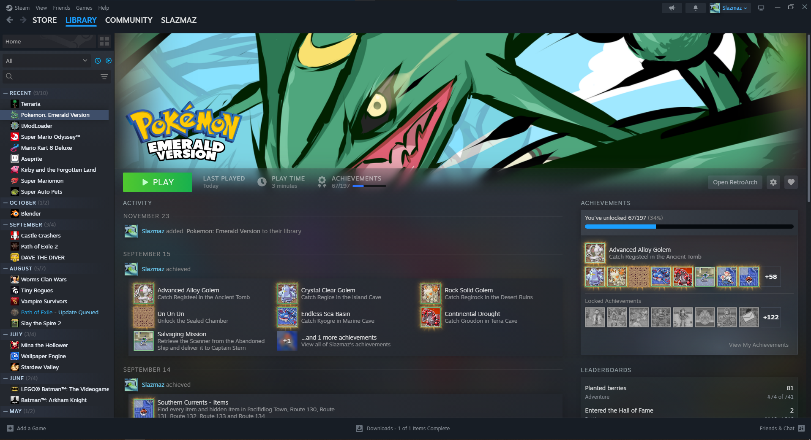

[](https://github.com/Slazmaz/FuseBox/releases/latest)
[](https://github.com/Slazmaz/FuseBox/releases/latest)
[](https://github.com/Slazmaz/FuseBox/releases/latest)
# FuseBox
An app that handles Steam integration for non-Steam games. Easily add non-Steam games to your Steam library with artwork, and/or open any game with Steam overlay and multiplayer. Also works with emulated ROMs.

*Only tested on Windows 10 and Nobara 44 KDE.*

## Features

- Add any game, app or ROM to your Steam library. (optional)
  - ``For ROMs you can assign your emulator of choice through the game's options inside FuseBox.``
- Pick cover, wide, hero, logo and icon art from [SteamGridDB](https://www.steamgriddb.com/), still or animated.
- View achievements, friends, and leaderboard data from [RetroAchievements](https://retroachievements.org/) from inside your Steam library.
- Invite friends to multiplayer through Steam.
  - ``After inviting a friend they can connect to you with the game's LAN features or by IP: 127.0.0.1``



## Launching Games

Games can be launched from FuseBox or your Steam library, but also with a command, for example in a terminal, script or desktop shortcut. They get the Steam overlay and multiplayer either way, even if they aren't in your Steam library.

```turtle
fusebox "<game path>" [--emulator "<emulator path>"] [arguments]

# <game path>                   the game's program, or the ROM
# --emulator <emulator path>    the emulator to use (default: the one set in FuseBox)
# [arguments]                   passed on to the game or emulator, e.g. -windowed

# Examples (Windows):
  C:\FuseBox\fusebox.exe "C:\Games\My Game\game.exe" -windowed -width 1280
  C:\FuseBox\fusebox.exe "D:\ROMs\My Game.gba"
  C:\FuseBox\fusebox.exe "D:\ROMs\My Game.gba" --emulator "C:\RetroArch\retroarch.exe"

# Examples (Linux):
  ~/FuseBox/fusebox ~/"Games/My Game/game" -windowed -width 1280
  ~/FuseBox/fusebox ~/"ROMs/My Game.gba"
  ~/FuseBox/fusebox ~/"ROMs/My Game.gba" --emulator /usr/bin/retroarch
```

## CLI

`fusebox-cli` gives other apps and scripts the library and its art.

```turtle
fusebox-cli version                               # Print FuseBox's version
fusebox-cli art <game> <type> [--no-fetch]        # Print the path of a game's art
fusebox-cli setart <game> <type> <image>          # Set a game's art
fusebox-cli listart <game> <type> [--animated]    # List a game's art from SteamGridDB
fusebox-cli list                                  # List all games found: id, name and art paths

# <game>        name, or id from list
# <type>        cover, wide, hero, logo or icon
# <image>       file, address, or id from listart (PNG, JPEG or WebP; icons only PNG)
# --no-fetch    do not fetch art from SteamGridDB if there is none yet
# --animated    list only animated art instead of still
```
